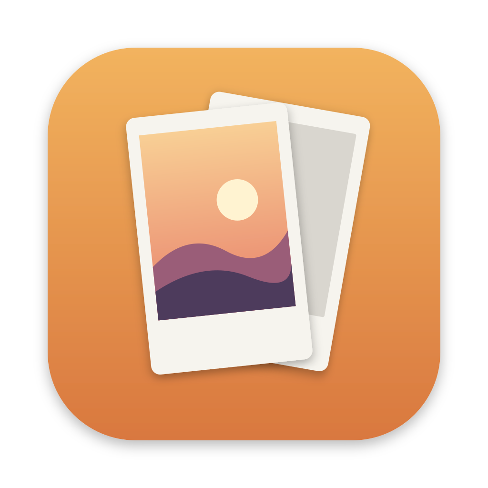
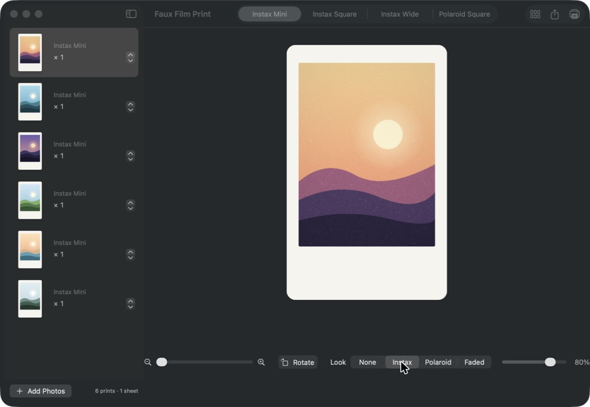
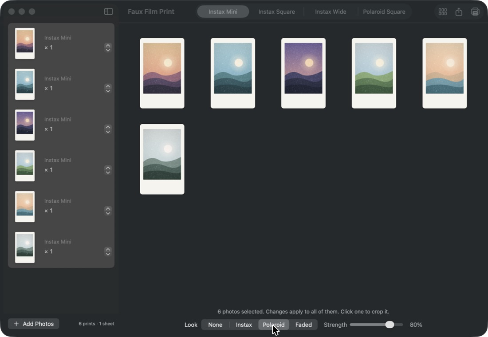
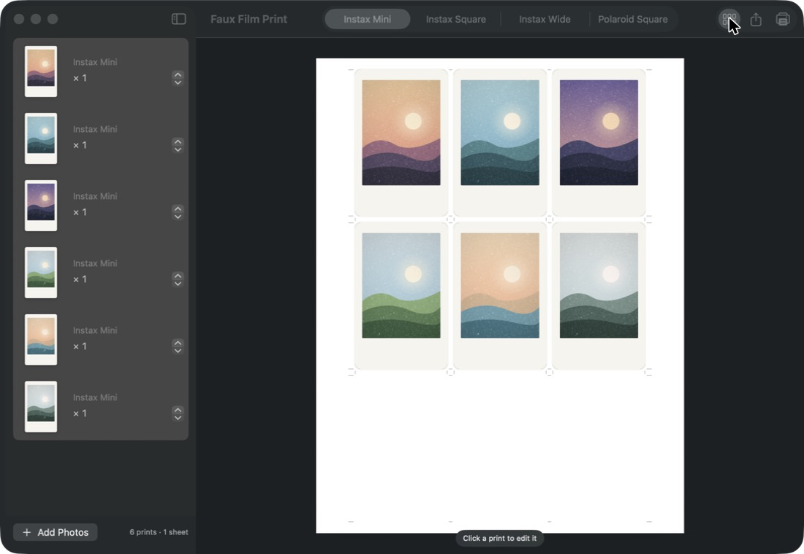

# Faux Film Print

<p align="center"></p>

A macOS app that turns photos into true-size instant-film prints (Instax Mini, Instax Square,
Instax Wide, Polaroid Square) and lays them out on US Letter sheets with crop marks for
cutting by hand, so they sit alongside real instant prints.

**[⬇ Download the latest release](https://github.com/JoshLedgard/faux-film-print/releases/latest)**: macOS 15 or later, signed and notarized by Apple.



## Features

- **Exact physical sizes**: Instax Mini (9 per Letter sheet), Instax Square, Instax Wide and Polaroid Square, printed at 100% and never scaled.
- **Made for hand cutting**: corner crop marks, a border bleed so slightly-off cuts don't leave white slivers, and optional corner-rounding guides.
- **Film looks**: Instax, Polaroid and Faded, each with a strength slider, applied to one photo or many at once.
- **Crop, zoom and rotate** each photo inside its frame.
- **Size test page** to check your printer against a real print before using glossy paper.
- **Saves your work** between launches, and never touches your originals.

| Apply a look to many photos at once | Preview the printed sheets |
|---|---|
|  |  |

## Download

Get `Faux-Film-Print-1.0.zip` from the [Releases page](https://github.com/JoshLedgard/faux-film-print/releases),
unzip it, and drag **Faux Film Print** into Applications.

## Using it

1. **Add Photos** (from your Photos library) or drag image files into the window.
2. Pick a format in the toolbar. It applies to the selected photos and to new ones.
3. Drag to move the photo in its frame, pinch or use the slider to zoom, and **Rotate** if needed.
4. Choose a **Look** and its **Strength**. Select several photos (⌘A for all) to change them together.
5. Toggle **Sheets** to preview the printed pages. Click a print to jump back to editing it.
6. **File ▸ Print Size Test** first. Print it on plain paper and check it against a real print.
7. **Print** at 100%. If your printer can't reach close enough to the paper edge, Faux Film Print prints
   fewer per sheet instead of shrinking anything.

Your photos and their crops are saved automatically and come back next time. Faux Film Print keeps
its own copy of each photo in its private storage folder and never changes your originals.
Removing a photo from the list deletes that copy.

Settings (⌘,) has print brightness (inkjet prints often come out darker than the screen),
corner rounding guides and an optional border texture.

Border sizes live in `FauxFilmKit/Sources/FauxFilmKit/Geometry.swift`. Tweak them there after a test print.

## Build

Requires Xcode 16+ and [XcodeGen](https://github.com/yonaskolb/XcodeGen) (`brew install xcodegen`).

```bash
xcodegen generate
open FauxFilm.xcodeproj
```

Run the **FauxFilm** scheme. The project file is generated, so re-run `xcodegen generate`
after adding or removing files.

## Tests

All layout, crop, rendering and PDF logic lives in `FauxFilmKit` and is tested there:

```bash
cd FauxFilmKit && swift test
```

## Releasing

`scripts/release.sh 1.1` builds, signs with Developer ID, notarizes, staples and zips the app into
`build/dist/`. Then attach it to a GitHub release.

## License

MIT. See [LICENSE](LICENSE).
